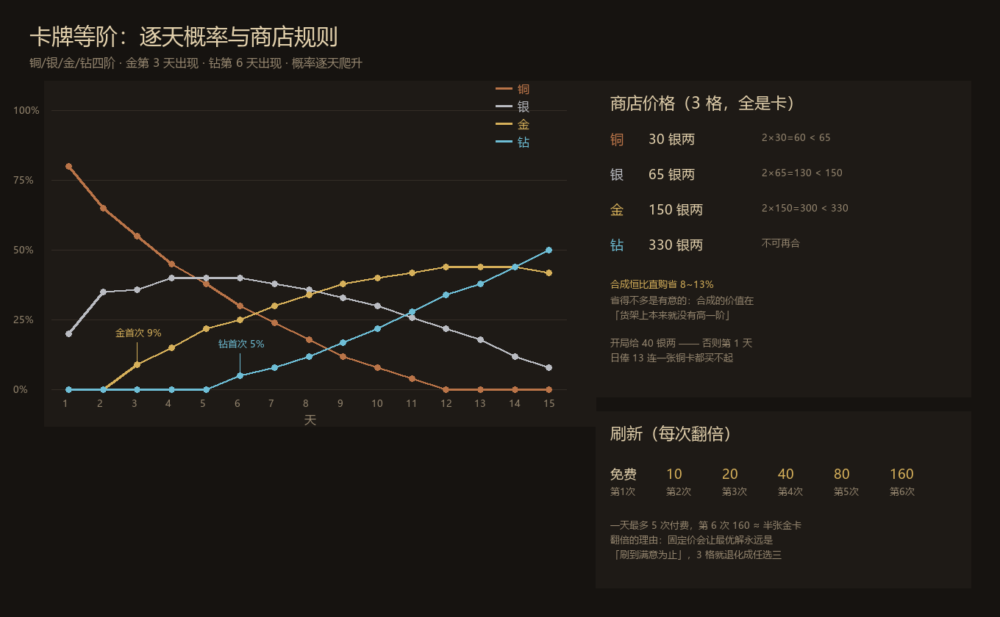

# 卡牌等阶与商店

> 落实日期：2026-11-24。规则原文：「卡牌分铜银金钻，前两天没有金钻，第三天小概率出金，第六天小概率出钻，
> 每天高稀有的等阶的卡牌概率会慢慢变高；**再获得一张同名卡就自动升一阶**（铜起步的一步步升到钻阶），
> 有些卡牌起步不是铜阶；一般数值类卡牌进阶按卡牌最低阶为基准，每高一阶加 0.5 到 1 倍，
> 机制类的可能就减少量蓄能时间；商店货架就 3 张卡牌，不同阶的卡牌花费不一样，可以花费刷新，每次刷新花费翻倍。」

配套代码：`Scripts/Game/Config/CardTierRules.cs`（规则与价格）、`CardConfig.MinTier`（起步阶）。

---

## 一、四阶

| 阶 | 代号 | 定位 | 一局内的获取难度 |
| --- | --- | --- | --- |
| 铜 | `Copper` | 起手、铺场、试构筑 | 随便买 |
| 银 | `Silver` | 构筑主干 | 第 1 天起就能遇到 |
| 金 | `Gold` | 定流派的关键件 | **第 3 天**才有小概率 |
| 钻 | `Diamond` | 一局的目标件、终式 | **第 6 天**才有小概率 |

> 卡牌四阶，与敌人的「青铜/白银/黄金/钻石/传奇」五阶**不是同一套**。
> 敌人有传奇，卡牌没有 —— 卡的顶端是钻，敌人的顶端是传奇。

---

## 二、逐天概率

商店三个格子每格独立按这张表抽阶，再在该阶的卡池里随机取一张。

| 天 | 铜 | 银 | 金 | 钻 | 备注 |
| --- | --- | --- | --- | --- | --- |
| 1 | 80% | 20% | — | — | 没有金钻 |
| 2 | 65% | 35% | — | — | 没有金钻 |
| 3 | 55% | 36% | **9%** | — | 金首次出现，一手能赌 |
| 4 | 45% | 40% | 15% | — | |
| 5 | 38% | 40% | 22% | — | |
| 6 | 30% | 40% | 25% | **5%** | 钻首次出现 |
| 7 | 24% | 38% | 30% | 8% | |
| 8 | 18% | 36% | 34% | 12% | |
| 9 | 12% | 33% | 38% | 17% | |
| 10 | 8% | 30% | 40% | 22% | 金超过铜，构筑进入后半段 |
| 11 | 4% | 26% | 42% | 28% | 铜开始退场 |
| 12 | — | 22% | 44% | 34% | 铜移出 |
| 13 | — | 18% | 44% | 38% | |
| 14 | — | 12% | 44% | 44% | 金钻各半 |
| 15+ | — | 8% | 42% | 50% | 钻超过金，终局段 |

设计要点：

1. **铜到第 12 天才移出**，比敌人的青铜（第 6 天移除）晚一周。理由不同：敌人移出青铜是为了不让三选一退化成三个垃圾；
   而商店的铜是**升阶材料**，第 12 天前还需要它去凑「第二张同名卡」。第 12 天后玩家牌组基本定型，铜才没有意义。
2. **金在第 3 天、钻在第 6 天**，严格照要求。9% 和 5% 都落在「小概率」的正常解读里。
3. **每阶的权重曲线是单调的**：铜一路降、银先升后降、金先升后平、钻一路升。
   没有出现「某天钻比金多」以外的突跳（第 15 天钻超过金是刻意的终局感）。
4. 敌人池用同一张表的**品阶**（青铜/白银/黄金/钻石/传奇）时，是把这张表向更高档平移，
   见 `Docs/遭遇池与BGM.md`，两表不通用。



---

## 三、起步阶：不是所有卡都从铜起

配置字段 `CardConfig.MinTier`。278 张的分布：

| 起步阶 | 张数 | 是些什么 |
| --- | --- | --- |
| 铜 | 95 | 基础兵器/护具/丹/蛊/符（含 2 张起始专用卡，不进商店）、四家族的起手式（穿云裂石、断月波、虎噬、余霞成绮、灵蛇出洞、狐御天雷、观音咒、气疗术、冰心诀…）、两张「入门本命卡」（145 聚灵阵 · 阵术、146 唤灵 · 御灵，为「起始 8 张全铜」而补） |
| 银 | 108 | 中段兵器与法术、本命第二三式、常见法宝、五行阵术中的火冰风雷土 |
| 金 | 58 | 改上场数的器物（捆仙索/七星灯/如意玄武遗）、敌全体冰冻（驱魔香/风雪冰天前的单点位）、变身（化狐/梦蛇）、回梦/鬼降、御灵主力、金刚阵术、顶级兵器（炙天煞、云出无心）、北冥玄珠 |
| 钻 | 17 | **四家族终式**（虎踞鲸吞、晚霞烂然、五蛟灭世、夺魂）+ 赎魂 + 天香续命露 + 风雪冰天 + 北冥玄珠外的最强法宝 + 吸星锁 |

三条判定规则（给以后加卡用）：

1. **能改「上场数 / 敌我手牌 / 全场冰冻」的，起步金。** 这类机制一旦在铜阶出现，前 5 天就没有难度了。
2. **带 `Ultimate` 标签的，起步金或钻。** 绝学本来就该是「摸到了才算赢」。
3. **其余按基础效果的强度定**：伤害 5~12（或等价护体/治疗）→ 铜；13~20 → 银；21 以上或带双机制 → 金。

> **代价要说清**：起步金/钻的 38 张卡**合不出来**（见第四节），只能靠掉落或直接买。
> 也就是说，一局能不能摸到「虎踞鲸吞」全看运气 —— 这是刻意的，让绝学有「抽到就爽」的稀有度；
> 但如果你希望每个主角的终式都稳定可见，就得把本命终式改成起步铜（可合），
> 代价是 8 张铜换一张钻，终式会变成保底件，不再稀有。

---

## 四、2 合 1 升阶

> **2026-11-27 废止：花钱的 2 合 1 已删除。** 升阶只剩两条路 ——
> ① **再获得同名卡**（拾取 / 购买，`RunState.AddCard` 自动升阶，牌组张数不变）；
> ② **百炼台的「合成」选项**（两张数值与蓄势相加，第二张消失）。
> 留着「花 15 两点一下」只会让玩家问：为什么我要为自动发生的事付钱？下面这段保留作历史记录。

~~**规则**：同名（同 `CardId`）+ 同阶的 2 张，合成 1 张高一阶。~~

| 项 | 规定 |
| --- | --- |
| 材料 | 2 张同名同阶；阶必须一致（银 + 铜 不能合） |
| 产物 | 1 张同名、阶 +1 |
| 费用 | **15 银两/次**（2026-11-24 加的；原本免费） |
| 上限 | 钻阶不能再合 |
| 时机 | 非战斗时随时可做（牌组界面），不占时辰 |
| 可否合出起步阶以下的卡 | 不可以。铜起 3 次到钻，银起 2 次，金起 1 次，钻起不能合 |

**为什么现在收费**：原设计是免费。实测一局余银 277~455 花不掉，而合成是「两张变一张更强的」的纯增益，
收费 15 两是最干净的一档硬 sink（一局合 5~7 次正好吃掉 75~105）。
成本仍然由「凑齐两张同名」承担，15 两只是不让人无脑合。

**为什么严格「同名」而不是「同阶任意两张」**：任意两张同阶可合，会让玩家把不要的垃圾卡
喂成一张钻，等于用无效卡换有效卡，构筑会失去取舍。同名才合，意味着你必须为某个方向重复投入。

**为什么「同阶」**：银 + 铜 能合的话，玩家会先买最便宜的铜，靠堆铜卡当垫子，银价就没有意义了。

### 货架对齐牌组阶位（2026-11-27）

**规则**：牌组里已经有某个族，这家店就只卖该族**最高那一阶** —— 但不得突破**当天的品阶上限**；
已经到钻（且当天允许钻）的族直接撤柜。

为什么：同族再获得会自动升阶，升的是「牌组里阶位最低那张」。如果牌组已经是「大刀·银」，
店里却摆「大刀·铜」，买下来只是把银升成金 —— **花铜的钱办银的事**，玩家会觉得莫名其妙。
对齐之后买到的永远是和手上同阶的那张，升一阶就够。钻卡撤柜是因为买了也升不上去，纯浪费 240 两。

实现：`ShopStock.AlignToDeck(deck)`，在 `Open` / 每次 `Restock` 之后跑一遍，价格按对齐后的阶位重算。

**天数上限**：`ShopStock.MaxTierToday()` = `CardTierRules.DayWeights(day)` 里最后一个非零项。
D1 只有铜银、D2 权重是 65/35/0/0、D6 起才有钻。所以「牌库有金大刀、第二天照样刷不出金卡」是硬约束 ——
`AlignToDeck` 对齐时按 `min(牌组最高阶, 当天上限)` 夹一次，`PickForShop` 往上找「有货的阶」时也传了这个上限。

**每格先 roll 阶位、再在该阶里抽卡**（这个顺序本来就是这样）：
`Restock` 里每格独立 `RollTier(day, grade, rng)`，然后 `PickForShop` 只在该阶的候选池里抽。
两个格抽到同一族会被 `usedIds`（按 BaseId）挡掉。

实测（连刷 300 次店）：

| 场景 | 结果 |
| --- | --- |
| 第 2 天 + 牌组有大刀·金（上限银） | 大刀出现 16 次，**全部 ≤ 银**，0 次破上限 |
| 第 9 天 + 牌组有大刀·金（上限钻） | 大刀出现 4 次，**全部是金**，0 次破上限 |

### 合成与商店的价格不等式

设同阶价为 `P(N)`，必须满足 `2 × P(N) < P(N+1)`，否则「直接买高一阶」永远比「买两张合」便宜，合成没人用。
下表是**寻常店**的价（上等店 +10%、珍稀店 +25%，见第六节）。

| 阶 | 价格 | 两张低阶合计 | 合成省 |
| --- | --- | --- | --- |
| 铜 | 20 | — | — |
| 银 | 45 | 40 | 5（11%） |
| 金 | 105 | 90 | 15（14%） |
| 钻 | 240 | 210 | 30（13%） |

省得不多，这是有意的：合成的价值主要在「货架上本来没有高一阶」，不在「省钱」。

---

## 五、升阶的数值规则

**基准是「这张卡的 `MinTier`」，不是全局铜阶。** 也就是说：起步银的卡，银阶就是它的原始数值，
升到金只乘一次，升到钻乘两次 —— 而不是从铜开始算并给它一个虚假的低起点。

### 5.1 三条公式

| 卡的类型 | 效果数值 | 蓄势时间 |
| --- | --- | --- |
| 纯数值（只有伤害/法术/护体/治疗/毒） | 每阶 × **1.60**（慢卡）/ 1.45（中速）/ 1.35（快卡） | 不变 |
| 数值 + 机制（既打伤害又带冰冻/多重/破绽） | 同上 × **0.85** 折扣 | 每阶 × **0.95** |
| 纯机制（改上场数、时机、充能，无数值） | 不放大 | 每阶 × **0.90** |

**为什么快卡要单独压一档**：同乘数下，`dps = 伤害 / 冷却`，冷却越短，乘数放大后的绝对 dps 越高。
实测过：钻阶大刀（1.8 秒）是 33 伤 / 每 1.8 秒 ≈ 18.3 dps，而钻阶绝学「虎踞鲸吞」（6 秒）只有 40 / 6 ≈ 6.7 dps。
不压的话，**升满阶的快卡会把所有绝学挤成废牌**。压完快卡后，两者差 2 倍左右，仍在可接受区间。

**为什么机制类只缩蓄势、不放大数值**：机制类卡的收益是「多上一个牌 / 冻住对手 / 多重结算」，
这些效果放大（比如上场数 +2 → +3）会让内核的 `HandMax = 8` 直接撞顶，等于送分。
所以升阶只让它**更早触发**，把「多久一次」当成稀缺资源来涨。

### 5.2 实例表

| 卡 | 起步 | 铜 | 银 | 金 | 钻 | 说明 |
| --- | --- | --- | --- | --- | --- | --- |
| 大刀（8 伤 / 1.8s） | 铜 | 8 | 11 | 15 | 20 | 快卡 ×1.35 |
| 月牙刀（12 伤 / 2.6s） | 银 | — | 12 | 17 | 25 | 中速 ×1.45 |
| 虎噬（6 伤 / 3.0s） | 铜 | 6 | 10 | 15 | 25 | 慢卡 ×1.60 |
| 虎踞鲸吞（40 伤 / 6.0s） | **钻** | — | — | — | 40 | 起钻，不可合 |
| 捆仙索（敌上场 −1 / 4.0s） | **金** | — | — | 4.0s | 3.6s | 纯机制 ×0.90 |
| 满天花舞（5 伤 ×多次 / 2.2s） | 银 | — | 5 | 6 | 7 | 混合 ×1.15 |
| 乾罡神镜（12 法 ×2 / 4.6s） | 金 | — | — | 12 | 16 | 混合 ×1.36 |

> 上表的「银/金/钻」列空着表示该卡到不了那个阶（起步就是金）。
> 数值由 `CardTierRules.ScaledValue` / `ScaledCountdown` 计算，改系数即可全表生效。

### 5.3 不跟着涨的字段

破绽层数（最多 3 层已封顶）、时机秒数（加速/减速/冰冻的持续）、上场数（受 `HandMax` 约束）、
`MultiCount`。这些字段升阶**原值不变**，只靠冷却缩短来提高频率。
理由同上：它们的上限是内核写死的，放大只会撞顶或让战斗瞬间结束。

> ⚠ 实现提醒：`CardTierRules.ScaledValue` 是通用函数 —— 传什么放大什么。
> 调用方**只对 `Damage / Spell / Shield / Heal / Poison` 调用它**，`Expose` 直接取原值。
> 卡表里破绽一栏写的是「不涨」而不是数值序列，就是这个原因。

### 5.4 一个有意的不对称：起钻卡不是「最强」

钻起步的 9 张卡里，有几张的原始数值**低于**同族满阶可合卡：

| 对比 | 起钻卡（不可合） | 同族满阶可合卡 |
| --- | --- | --- |
| 小虎 | 虎踞鲸吞 40 伤 / 6.0s（Remove，打一次就没） | 猛虎出闸 钻 56 伤 / 4.0s |
| 沈欺霜 | 晚霞烂然 26 法 / 5.0s | 云兴霞蔚 钻 27 法 / 3.0s |
| 苏媚 | 夺魂 40 伤 / 5.0s（Remove） | 杯弓蛇影 钻 23 伤 / 2.6s |

这不是算错，是两条获取路径的成本差：**起钻卡省事（买到就有），满阶可合卡要花 8 张铜**。
如果起钻卡还比满阶卡强，那就没人走合成路线了。

但代价是：这几张终式在「已经有一张满阶可合卡」之后会显得没用。
**解法不是改数值，是给它们触发器** —— 虎踞鲸吞需要虎煞满 6 层才能打出，夺魂需要目标气血低于 30%。
这类「条件触发」属于独有资源机制，见 `Docs/装备与技能设计.md` 的待建清单，
在触发器落地之前，这几张卡的强度确实偏低，属于已知缺口。


---

## 六、商店

### 6.1 分店制：一家店，一个品类，一档货

2026-11-24 改。原来是「3 格全随机」，现在是**每次进集市时辰开一家店**（2026-11-25 货架 3 → 4 格）：

```
店 = 品类（卖什么） × 档次（卖多好的）
```

> **档次不是阶位。** 档次说的是「这家店的整体水平」（影响它抽到各阶的权重，也影响价格），
> 具体每一张货还是各有自己的阶位（铜/银/金/钻），价格按那张货自己的阶算。
> 所以「珍稀药铺」里既可能有一张银阶的糯米，也可能有一张钻阶的天香续命露。

**品类（9 种，概率见括号）**

| 品类 | 卖什么（按标签） | 概率 |
| --- | --- | --- |
| 杂货摊 | 不限品类，只排除别派本命卡 | 6% |
| 兵器铺 | `Blade` `Sword` `Whip` `Spear` | 12% |
| 防具铺 | `Armor` `Fan` | 12% |
| 药铺 | `Pill` | 12% |
| 符咒铺 | `Talisman` | 12% |
| 蛊铺 | `Gu` | 10% |
| 器物阁 | `Charm` | 12% |
| 暗器铺 | `Dart` | 10% |
| 武学馆 | 家族招式（`Palm` `SaberArt` `Tiger` `SwordArt` `Formation` `Serpent` `Fox` `Transform` `Spirit` `Incantation`），**只卖当前主角的** | 14% |

**档次（3 种，按天解锁）**

| 档次 | 阶位偏向 | 出现条件 |
| --- | --- | --- |
| 寻常 | 铜 +25 权重 | 天天有 |
| 上等 | 铜 ÷2、银 +10、金 ×2 | 第 3 天起 35%，第 6 天起 50% |
| 珍稀 | 铜归零、银 ÷2、金 ×2、钻 ×3 | 第 8 天起 20% |

阶位上仍然受**当天的阶位概率表**约束：珍稀店在第 3 天也只能卖到金，因为那天钻的概率是 0。
档次只做「倾斜」，不突破天数。

**价格叠加档次溢价**：上等 +10%、珍稀 +25%（见 6.2 表）。档次高不只是货好，也贵一点。

**两类特殊店**

- **武学馆**只卖当前主角的本命招式。它是「升阶」的主要来源 —— 本命池只有 13~18 张，
  逛两次武学馆很容易买到同名同阶的两张，进而 2 合 1。这是分店制带来的副作用，也是好事：
  「本门武学可以精进」比「随便什么卡都能合」更说得通。
- **器物阁**没有铜阶货（最便宜的法宝是银阶的玉菩提），所以在铜阶会**自动上溯到银阶**卖，
  价格按银阶算。结果就是：早期遇到器物阁，多半是「看得见买不起」—— 法宝本来就不是新手能买的。

**刷新不换店**：刷新 = 同店重新进货。换店会让「店」这个概念失去意义。

**已删除「补对位」**（旧版第三格优先给能凑成合成对的卡）。用户明确不要：
商店不该为合成服务，凑对应该靠玩家自己逛对店、买对货。
实测（20 局/主角）：删掉后**合成仍然平均 5~8 次/局**，主要来自开局牌组自带的重复，
以及武学馆里反复买到同门招式。

### 6.1.1 货架

**4 格，全部来自这家店的池子。** 器物、丹药、符咒本身就是卡（本项目「装备道具技能都是卡牌」），
不需要单独的格子。

不设「服务格」：删牌是固定服务，放在货架下方作为常驻按钮（每天限次），不占随机格。

### 6.2 价格

| 阶 | 价格（寻常店） | 上等店 | 珍稀店 | 一次日俸能买吗 |
| --- | --- | --- | --- | --- |
| 铜 | 20 | 22 | 25 | 第 1 天就能买 |
| 银 | 45 | 50 | 56 | 要存 1~2 天 |
| 金 | 105 | 116 | 131 | 要存 3~5 天 |
| 钻 | 240 | 264 | 300 | 基本只能靠攒或掉落 |

**开局给 40 银两**（旧文档没有这一项，是本轮新增）。没有它，第 1 天日俸 13 银两连一张铜卡都买不起，
集市这个时辰等于空白。

### 6.3 刷新：每次翻倍

| 第几次 | 花费 | 累计 |
| --- | --- | --- |
| 1（当天首次） | **免费** | 0 |
| 2 | 10 | 10 |
| 3 | 20 | 30 |
| 4 | 40 | 70 |
| 5 | 80 | 150 |
| 6 | 160 | 310 |

一天最多 5 次付费刷新（即最多 6 次看货），第二天归零。

**为什么翻倍而不是固定价**：固定 15 银两一次，最优解永远是「刷到满意为止」，
4 格货架就退化成一个 45 银两的四选一。翻倍让第二次刷开始疼，**逼玩家接受不完美的货架**，
这才是「4 格」的意义。第 6 次 160 银两，相当于半张金卡 —— 没有人会为了一张铜卡刷到那一步。

### 6.4 常驻服务

| 服务 | 价格 | 限制 |
| --- | --- | --- |
| 删牌 | 60 | 一局 5 次 |
| 淬炉附魔 | 免费 | 每天 1 次、每卡 1 个（在淬炉时辰做，不在商店） |

---

## 七、经济：sink 补完后的实测

按「开局 40 + 日俸 `10+3×等级` + 遭遇按品阶 18~68 + 宿敌胜 40」估算，10 天收入约 **940**。

### 7.1 三个 sink 的调整（2026-11-24）

| 项目 | 原值 | 现值 | 为什么 |
| --- | --- | --- | --- |
| 合成手续费 | 0 | **15 两/次** | 合成是纯增益，一局合 5~7 次正好吃掉 75~105 |
| 遭遇奖励 | `20 + 3×天` | **按品阶 18/26/36/50/68** | 不再随天数涨，改挂品阶（见 `Docs/局内流程设计.md` 第十节） |
| 删牌 | 60 两 × 3 次 | **60 两 × 5 次** | 硬 sink 从 180 提到 300，同时给「牌组太厚」一个出口 |

### 7.2 实测（20 局/主角，固定 65% 单场胜率）

| 主角 | 平均天数 | 胜场 | 余银 | 合成 | 最终牌组 |
| --- | --- | --- | --- | --- | --- |
| 王小虎 | 11 | 6 | **42** | 5 次/局 | 铜 12 / 银 16 / 金 2 / 钻 0 |
| 沈欺霜 | 11 | 6 | **39** | 7 次/局 | 铜 9 / 银 13 / 金 5 / 钻 0 |
| 苏媚 | 11 | 6 | **33** | 7 次/局 | — |
| 李忆如 | 11 | 6 | **38** | 7 次/局 | — |

**调整前是 277~455，现在是 33~42。** 四位主角的余银落在同一个区间，说明三档 sink 的力度刚好：
钱能花完，但不是「买不起」——而是「每一枚都得决定花在哪」。

不进则退的一点：余银 33~42 意味着**没有容错**。一次错误购买（比如花 131 买了一张用不上的珍稀金卡）
就会让后面两天买不起东西。这是「紧平衡」的另一面，如果实测觉得太苦，把合成手续费降到 10 或遭遇回到 `18+2×天`。

### 7.3 sink 的构成（一局 10 天）

| 类型 | 项目 | 金额 | 性质 |
| --- | --- | --- | --- |
| 软 | 买卡 | ~350 | 钱变成战力 |
| 软 | 买器物 | ~100 | 同上 |
| **硬** | 删牌 5 次 | 300 | 钱消失，换牌组变薄 |
| **硬** | 合成 5~7 次 | 75~105 | 钱消失，换一张高阶 |
| **硬** | 刷新 | ~100 | 钱消失，换一次机会 |
| **硬小计** | | **475~505** | 与收入 890 的 55% |

硬 sink 占到收入的一半以上，这是健康区间 —— 低于 30% 钱就会开始堆积。

## 八、待验证的三个风险

1. **第 3 天 9% 出金，会不会太早**：金卡里包括「敌全体冰冻」「改上场数」这类强机制，
   第 3 天玩家的牌组只有 16~18 张，摸到一张金就能跳一级强度。若实测「第 3 天买到金直接碾过第 4~6 天」，
   把金起始天推到第 4 天（9% → 0，第 4 天 15%），只调这一格，不动曲线。
2. **钻卡 9 张、第 14 天 44% 概率**：意味着终局段每 2 次刷新就有一张钻，但钻池只有 9 张，
   会出现「同一张钻反复出现」。好在同名钻能继续合（需要 2 张）—— 但如果玩家已经有一张钻，
   再见到同名钻就是废货。**解法**：抽卡时排除「玩家已有该卡同阶」的项（去重），
   这会让终局的 4 格更有价值。这一条要等 `RunState` 有了牌组快照才能实现。
3. **起步金的 29 张卡在 4 格货架里可能整局见不到**：商店一局开 10~13 次 × 4 格 ≈ 45 个商品位，
   金+钻合计约 30 张，理论上能覆盖，但按概率只有一部分会撞上。若玩家反馈「我的流派核心从没出现」，
   加一条保底：**每 3 天至少保证 1 格是本命卡**（`Master` 匹配）。

---

## 九、接口（给下一步实现）

```csharp
// 已存在：起步阶
public CardTier MinTier;          // CardConfig

// 已存在：规则与价格
CardTierRules.PriceOf(tier)             // 30 / 65 / 150 / 330
CardTierRules.RefreshCost(paidIndex)    // 10 / 20 / 40 / 80 / 160
CardTierRules.DayWeights(day)           // 当天四阶权重
CardTierRules.ScaledValue(card, base, tier)
CardTierRules.ScaledCountdown(card, base, tier)

// 待建（RunState 落地时一起做）
sealed class RunCard { public int CardId; public CardTier Tier; }
// 牌组从 List<int> 改成 List<RunCard>，合成、商店、存档都读它
```

> ⚠ 现在 `CharacterConfig.Deck` 是 `List<int>`，**没有阶**。合成本质上改的是牌组里的实例，
> 所以这一项要等 `RunState`/`RunCard` 建起来才能实现 —— 现在只有「规则」和「起步阶」，
> 还没有「一张已经升到银阶的大刀」这种东西。
